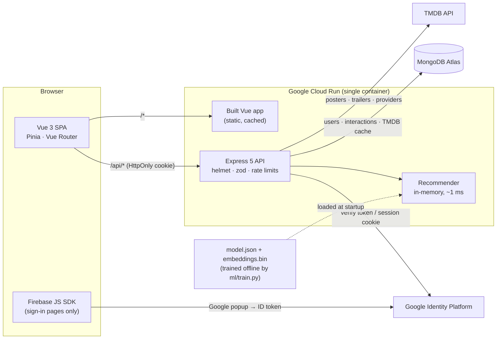
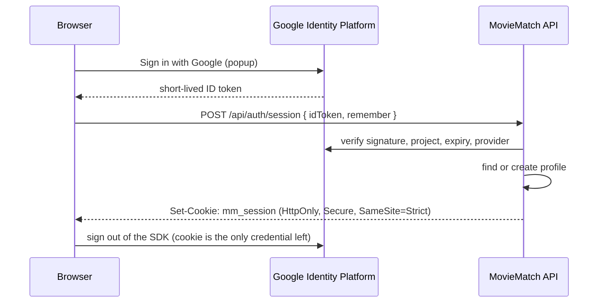
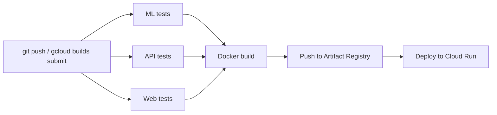

<div align="center">

# 🎬 MovieMatch

**Personal movie recommendations that explain themselves.**

Take a one-minute taste quiz, then get picks you'll actually enjoy, each with a reason.<br/>
Every 👍 or 👎 changes the next set of picks straight away, with no retraining.

[**▶ Live demo**](https://moviematch-546gwzmkkq-uc.a.run.app) ·
[How it works](#-how-it-works) ·
[The ML model](#-the-machine-learning-model) ·
[API reference](#-rest-api-reference) ·
[Run it locally](#-run-it-locally)


</div>

---

## 📑 Contents

1. [Features](#-features)
2. [How it works](#-how-it-works)
3. [Tech stack](#-tech-stack)
4. [External APIs & data sources](#-external-apis--data-sources)
5. [The machine-learning model](#-the-machine-learning-model)
6. [REST API reference](#-rest-api-reference)
7. [Data model](#-data-model)
8. [Authentication & security](#-authentication--security)
9. [Visual design: "Midnight Programme"](#-visual-design-midnight-programme)
10. [Project structure](#-project-structure)
11. [Run it locally](#-run-it-locally)
12. [Tests](#-tests)
13. [Deploy to Google Cloud](#-deploy-to-google-cloud)
14. [Performance](#-performance)
15. [Known limitations](#-known-limitations)
16. [Credits](#-credits)

---

## ✨ Features

| | |
|---|---|
| 🧭 **Taste quiz** | Pick genres to avoid or enjoy, a few favourite films, moods (*feel-good, mind-bending, dark…*), eras, who you're watching with, and how adventurous you are (*crowd-pleasers ↔ hidden gems*). Every answer card has real posters. |
| 🎯 **Personal home page** | *Top picks for you*, *Because you liked X*, *Hidden gems for you* and rows for your favourite genres, all loaded in one request. |
| 💬 **Explained picks** | Every recommendation comes with a short reason, such as *"Because you liked Inception · mind-bending"*, and a match score. |
| 👍 **Instant feedback loop** | Like, dislike, watchlist or mark as watched. The next recommendations take it into account immediately. |
| 🎞️ **Trailers** | Official trailers from TMDB, played in YouTube's privacy-enhanced (`youtube-nocookie.com`) player. |
| 📺 **Where to watch** | Streaming, free, rent and buy options for each film in your country (JustWatch data via TMDB), with a country picker. |
| 🔎 **Search & browse as a guest** | Guests can browse curated rows and search the catalogue. You only need to sign in to like or save films. |
| 📚 **Library** | Your watchlist, liked films and watched films in one place. |
| 🔐 **Google sign-in** | One button. Includes "Remember me", "Sign out of all devices" and account deletion. |
| 🎨 **Original design** | A printed film-festival look: ticket-stub match scores, generated screen-print posters, and a 3-2-1 film-leader countdown. |

---

## 🧩 How it works



**A typical journey:**

1. **Browse as a guest.** `/api/browse` serves curated rows (popular, top-rated, genres, hidden gems), computed once an hour and shared by all visitors.
2. **Sign in with Google.** The browser gets an ID token from Identity Platform and exchanges it at `POST /api/auth/session` for an HttpOnly session cookie.
3. **Take the quiz.** Answers are saved with `PUT /api/preferences`.
4. **Get recommendations.** The server builds a **taste vector** from your answers and reactions, scores all 3,650 movies against it, re-ranks the results for diversity, and attaches reasons and TMDB posters.
5. **React.** `PUT /api/interactions/:movieId` saves 👍/👎/watchlist/watched. The next request uses it right away.

---

## 🛠 Tech stack

### Frontend: `frontend/`
| Technology | What it does here |
|---|---|
| **Vue 3** (Composition API, `<script setup>`) | UI components and views |
| **Vite 8** | Dev server with hot reload and the production build (hashed, code-split chunks) |
| **Pinia** | State stores: `auth` (current user, session) and `ui` (toasts, modal) |
| **Vue Router** | Lazy-loaded routes with guards for guest, signed-in and onboarding pages |
| **Firebase JS SDK** | Google sign-in popup. Loaded **only** on the sign-in pages |
| **Plain CSS** with custom properties | The whole design system, with no CSS framework (~55 KB gzipped first load) |
| **Vitest + Vue Test Utils + jsdom** | Component and flow tests |

### Backend: `backend/`
| Technology | What it does here |
|---|---|
| **Node.js 24** (ES modules) | Runtime |
| **Express 5** | HTTP API and static file server for the built SPA |
| **Mongoose 9** | MongoDB models: `User`, `Interaction`, `MovieMeta` |
| **firebase-admin** | Verifies Identity Platform ID tokens, issues and revokes session cookies |
| **zod** | Validation of every request body and query string |
| **helmet** | Security headers, including a strict Content-Security-Policy |
| **express-rate-limit** | Limits on public endpoints and session creation |
| **compression · cookie-parser · morgan** | gzip, cookie parsing, request logs |
| **Vitest + Supertest + mongodb-memory-server** | API integration tests against a real, temporary MongoDB |
| **firebase-tools** | Local Firebase Auth emulator for development and demos |

### Machine learning: `ml/`
| Technology | What it does here |
|---|---|
| **Python 3.12** | Offline training |
| **NumPy** | Matrix maths, TF-IDF, embedding fusion, evaluation metrics |
| **SciPy** (`sparse`, `sparse.linalg.svds`) | Sparse rating matrix and truncated SVD |
| **pytest** | Model and artifact tests |
| **Jupyter · matplotlib** | The fully documented training notebook |

### Infrastructure
| Technology | What it does here |
|---|---|
| **Docker** (multi-stage, `node:24-alpine`, non-root) | One image containing the API, the built SPA and the model |
| **Google Cloud Run** | Serverless hosting that scales to zero |
| **Google Cloud Build** | CI/CD: ML, API and web tests → image build → push → deploy |
| **Artifact Registry** | Stores the container images |
| **Secret Manager** | MongoDB URI and TMDB key, never baked into the image |
| **MongoDB Atlas** (on GCP) | Managed database |
| **Google Identity Platform** | Sign-in (Firebase Authentication) |

---

## 🌐 External APIs & data sources

| Service | Used for | Details |
|---|---|---|
| **[MovieLens `ml-latest-small`](https://grouplens.org/datasets/movielens/)** (GroupLens) | Training data | 100,836 ratings by 610 users, with genres, user tags and IMDb/TMDB ids. Used **offline only**. |
| **[TMDB API v3](https://developer.themoviedb.org/)** | Posters, backdrops, plot overviews, runtimes | `GET /movie/{id}`, cached permanently in MongoDB (`moviemetas`) plus an in-memory LRU, so each film is fetched **once**. |
| | Trailers | `GET /movie/{id}/videos`. Picks YouTube official trailers first; the result is cached and re-checked monthly. |
| | Where to watch | `GET /movie/{id}/watch/providers`. Kept in memory for 12 hours because availability changes often. |
| | Images | `image.tmdb.org`: `w342`/`w500` posters, `w1280` backdrops, `w92` provider logos. |
| **[JustWatch](https://www.justwatch.com/)** (via TMDB) | Streaming availability | Credited wherever the data is shown, as TMDB's terms require. |
| **YouTube** (`youtube-nocookie.com`) | Trailer playback | Privacy-enhanced embed; no cookies until the viewer presses play. |
| **[Google Identity Platform](https://cloud.google.com/identity-platform)** | Sign-in | Google provider only, through the Firebase JS SDK and `firebase-admin`. |
| **Google Fonts** | Typography | Big Shoulders Display, Newsreader, Courier Prime. |

The TMDB key is **optional**. Without it, the app still works fully and shows designed gradient poster cards instead of real posters. The client accepts either a v3 API key or a v4 read-access token.

---

## 🧠 The machine-learning model

**Dataset:** MovieLens `ml-latest-small`, the standard academic benchmark for recommenders. It's licensed for research and education and small enough to retrain in about a second. Movies with fewer than 5 ratings are dropped, which leaves **3,650 movies**.

**Model** ([`ml/moviematch_ml/model.py`](ml/moviematch_ml/model.py)) is a **hybrid embedding** with one 80-dimensional vector per movie:

1. **Collaborative filtering:** truncated SVD (k = 48) of the user-mean-centred rating matrix. Movies loved by the same people end up close together.
2. **Content:** TF-IDF over genres and user tags (for example "pixar", "mind-bending", "twist ending"), compressed with LSA (k = 32). This handles rarely rated movies (cold start).
3. **Fusion:** `[√α · collab, √(1−α) · content]`, so the dot product of two vectors is `α·cos_collab + (1−α)·cos_content`.

**Personalisation without retraining.** Your *taste vector* is the weighted sum of the movies you picked or liked (+) and disliked (−), plus the centroids of your favourite genres. A brand-new user gets personal results right after the quiz. At request time the API ([`backend/src/ml/recommender.js`](backend/src/ml/recommender.js)) adds:

- a **popularity prior**, scaled by your "crowd-pleasers ↔ hidden gems" answer;
- **mood, era and audience** boosts;
- **hard filters** for avoided genres (and family-unsafe titles in family mode);
- **MMR** (Maximal Marginal Relevance) re-ranking, so a row isn't ten near-identical films;
- a **human-readable reason** for each pick.

**Evaluation** uses a per-user *temporal* 80/20 split: each user's most recent likes are predicted from their earlier ones.

| Model | NDCG@10 | Recall@10 | Catalogue coverage |
|---|---|---|---|
| Popularity baseline | 0.076 | 0.075 | 2.6% |
| Content only (α = 0) | 0.045 | 0.049 | 18.2% |
| Collaborative only (α = 1) | 0.103 | 0.108 | 24.2% |
| **Hybrid (α = 0.9, β = 0.4), shipped** | **0.109** | **0.116** | **22.6%** |

Hyperparameters are chosen to maximise NDCG@10 **subject to ≥ 20% catalogue coverage**. Chasing accuracy alone pushes toward "show everyone the same blockbusters", which scores slightly better offline but makes a worse product. The full grid prints when you run `train.py`, and the live numbers appear in the app under *Profile → How MovieMatch picks for you*.

**Artifacts:** `train.py` writes `backend/model/model.json` (catalogue, metadata, parameters) and `backend/model/embeddings.bin` (a Float32 matrix, about 1.1 MB). The API loads both at startup.

<details>
<summary><b>Retrain the model</b></summary>

```bash
cd ml
python -m venv .venv && .venv/Scripts/pip install -r requirements.txt   # .venv/bin/pip on macOS/Linux
curl -LO https://files.grouplens.org/datasets/movielens/ml-latest-small.zip
mkdir -p data/raw && unzip ml-latest-small.zip -d data/raw
.venv/Scripts/python train.py           # writes ../backend/model/{model.json,embeddings.bin}
```
</details>

### 📓 The notebook

[`ml/notebooks/MovieMatch_Hybrid_Recommender.ipynb`](ml/notebooks/MovieMatch_Hybrid_Recommender.ipynb) is a full, executed walkthrough. Before every major cell it explains *the goal*, *the why* and *the key parameters*, in five phases:

1. **Environment & hardware:** CPU/GPU/BLAS detection, frozen run config, dataset download.
2. **EDA & preprocessing:** 11 data-integrity checks, distributions, and a leak-free temporal split.
3. **Architecture:** the maths, a shapes and parameter table (292k learned values), invariant checks, SVD spectra.
4. **Training:** a 126-trial grid search with a resumable JSONL checkpoint, coverage-constrained selection, a capacity curve, and export with a SHA-256 manifest.
5. **Evaluation:** baselines, a hyperparameter heatmap, the accuracy-vs-coverage frontier, Recall/NDCG@K curves, cold-start analysis by user activity, nearest neighbours, and serving latency.

It imports the core maths from `moviematch_ml`, so it can't drift from production; its exported embeddings are checked to be byte-identical to `backend/model/`. It writes only to `ml/artifacts/` unless you set `export_to_backend=True`.

```bash
cd ml && .venv/Scripts/pip install -r requirements-notebook.txt
jupyter lab notebooks/   # or open in VS Code; it runs in under 10 s on a laptop CPU
```

---

## 📡 REST API reference

All endpoints are under `/api` and return JSON. 🔒 = needs a session. 👤 = works for guests, with extra data when signed in.

### Auth: `/api/auth`
| Method | Path | Description |
|---|---|---|
| `GET` | `/auth/config` | Public web config for the Firebase SDK (API key, auth domain). No secrets. |
| `POST` | `/auth/session` | Exchange an Identity Platform ID token for the `mm_session` cookie. Body: `{ idToken, remember, name? }`. Rate-limited. |
| `GET` | `/auth/me` 🔒 | The current user's profile. |
| `POST` | `/auth/logout` | Clear the session cookie. |
| `POST` | `/auth/logout-all` 🔒 | Sign out of all devices (revokes Identity Platform tokens). |
| `DELETE` | `/auth/me` 🔒 | Delete the account, its history and the Identity Platform user. |

### Onboarding & preferences
| Method | Path | Description |
|---|---|---|
| `GET` | `/onboarding/options` | Quiz choices: genres, moods, eras, discovery levels, audiences. |
| `GET` | `/onboarding/previews` 🔒 | Posters for the mood, era and discovery cards. |
| `GET` | `/onboarding/seeds?genres=&limit=&offset=` 🔒 | Well-known films to pick favourites from. |
| `PUT` | `/preferences` 🔒 | Save the quiz answers and mark the user as onboarded. |

### Recommendations
| Method | Path | Description |
|---|---|---|
| `GET` | `/recommendations/home` 🔒 | All home-page rows in one round trip. |
| `GET` | `/recommendations?genre=&mood=&quality=&limit=…` 🔒 | Filtered recommendations (`quality`: `top-rated` or `hidden-gems`). |
| `GET` | `/model` | Model info and evaluation metrics (shown on the Profile page). |

### Movies & browsing
| Method | Path | Description |
|---|---|---|
| `GET` | `/browse` | Public landing-page rows. Cached for an hour. |
| `GET` | `/showcase` | Poster reel for the sign-in screens. |
| `GET` | `/movies/search?q=&limit=` 👤 | Title search. |
| `GET` | `/movies/:id` 👤 | Film details, similar films and trailer, plus your interaction if signed in. |
| `GET` | `/movies/:id/trailer` 👤 | Just the trailer (YouTube key and name), or `null`. |
| `GET` | `/movies/:id/providers?region=US` 👤 | Where to watch in a country, plus the list of countries with data. |

### Library
| Method | Path | Description |
|---|---|---|
| `PUT` | `/interactions/:movieId` 🔒 | Set `reaction` (`like`/`dislike`/`null`), `inWatchlist` and/or `watched`. |
| `GET` | `/library` 🔒 | Watchlist, liked and watched lists. |
| `GET` | `/library/state` 🔒 | Compact `{ movieId: state }` map so every button shows the right state. |
| `GET` | `/favorites` 🔒 | Favourite films picked in the quiz. |
| `GET` | `/health` | Liveness check (used by the Docker `HEALTHCHECK`). |

---

## 🗄 Data model

MongoDB has three collections:

```text
users            name, email (unique), firebaseUid (unique), providers[], avatarUrl,
                 sessionsValidAfter, onboarded, preferences { genres[], avoidGenres[],
                 favoriteMovies[], moods[], eras[], discovery, audience }, timestamps
interactions     user → users._id, movieId, reaction (like | dislike | null),
                 inWatchlist, watched, timestamps             (unique on user + movieId)
moviemetas       _id = MovieLens id, posterPath, backdropPath, overview, runtime,
                 trailerKey, trailerName, trailerCheckedAt     (TMDB cache)
```

The movie catalogue itself is not stored in the database. It lives in the model artifact and is held in memory.

---

## 🔐 Authentication & security

Sign-in is **Google-only**, through **Google Identity Platform** (Firebase Authentication). MovieMatch never sees or stores a password. Passwords, 2-step verification, account recovery and suspicious-sign-in protection all live in the person's Google account.

**How a session starts:**



- Only tokens from a sign-in **within the last 5 minutes** are accepted, so an old leaked token can't start a session.
- Only providers in `allowedProviders` ([`backend/src/config.js`](backend/src/config.js)) are accepted. Email/password or anonymous accounts created directly against Identity Platform get `403 PROVIDER_NOT_ALLOWED`.
- "Remember me" gives a 14-day cookie; otherwise it's a browser-session cookie (24 h maximum).

**Session security**
- The cookie is `HttpOnly` (JavaScript can't read it, so an XSS bug can't steal it), `Secure` in production, and `SameSite=Strict`. Tokens are never returned in JSON. API clients can send `Authorization: Bearer <ID token>` instead.
- **Sign out of all devices** revokes every session. Revocations made in Identity Platform (an admin disabling the account, for example) are also honoured within 60 seconds.
- **Deleting the account** removes the profile, its history and the Identity Platform user.
- A profile can only be claimed by a different identity with the same email if that email is *verified*, which blocks account takeover through unverified sign-ups.

**Request hygiene**
- CSRF protection: cross-site POST/PUT/DELETE requests are rejected using the `Origin` and `Sec-Fetch-Site` headers.
- Helmet with a strict CSP (only Identity Platform, the Google sign-in frame, TMDB images, YouTube-nocookie and Google Fonts are allowed).
- zod validation on every input, JSON bodies capped at 50 KB, and rate limits on public and session endpoints.
- API responses are `Cache-Control: no-store`.

**Production safeguards:** the server refuses to start without `MONGODB_URI`, `FIREBASE_PROJECT_ID` and `FIREBASE_API_KEY`, or if the auth emulator is configured. The container runs as a non-root user, secrets come from Secret Manager, and shutdown on Cloud Run's SIGTERM is graceful.

---

## 🎨 Visual design: "Midnight Programme"

The UI is styled after a printed film-festival programme rather than a generic streaming app.

- **Palette:** newsprint paper with film grain, ink black, and a single projector-red accent. Every colour is a CSS variable in [`frontend/src/styles/main.css`](frontend/src/styles/main.css).
- **Type:** *Big Shoulders Display* (a condensed face from Chicago marquee signage) for headlines; *Newsreader*, an editorial serif, for body text, with italics for the "why you'll like it" notes; *Courier Prime*, the screenplay typeface, for labels such as `INT. YOUR COUCH — TONIGHT`.
- **Generated posters:** films without a TMDB poster get a **screen-print**: two inks, a geometric motif, a halftone field and an offset "misregistered" title. The colours are hashed from the movie id, so they stay the same every time.
- **Motifs:** match scores are perforated ticket stubs, mood filters are punched tickets, the sign-in form is an admission ticket, and quiz answers are ruled index cards.
- **Motion (CSS only):** a marquee headline with chasing bulbs over a rolling film strip on the landing page, a staggered "Tonight's feature" reveal on the home page, and a film-leader **3-2-1 countdown** at the end of the quiz. `prefers-reduced-motion` turns all of it off.

---

## 📁 Project structure

```text
.
├── frontend/                 Vue 3 SPA
│   ├── src/views/            Landing, Auth, Onboarding (quiz), Home, Search, Library, Profile, Privacy
│   ├── src/components/       MovieCard, MovieModal, MovieRow, WhereToWatch, MoviePoster, …
│   ├── src/stores/           Pinia: auth, ui
│   ├── src/api.js            fetch wrapper (cookies, errors, cancellation)
│   └── tests/                Vitest
├── backend/                  Express API
│   ├── src/app.js            middleware, security headers, routing, static files
│   ├── src/routes/           auth.js, app-routes.js
│   ├── src/ml/recommender.js taste vectors, scoring, MMR, reasons
│   ├── src/services/         firebase.js (sessions), tmdb.js (posters, trailers, providers)
│   ├── src/models/           User, Interaction, MovieMeta (Mongoose)
│   ├── model/                trained artifacts: model.json, embeddings.bin
│   ├── scripts/demo.js       one-command demo (in-memory MongoDB + auth emulator)
│   └── test/                 Vitest + Supertest
├── ml/                       Python training pipeline
│   ├── moviematch_ml/        data.py, model.py, evaluate.py
│   ├── train.py              grid search → export to backend/model
│   ├── notebooks/            documented Jupyter walkthrough
│   └── tests/                pytest
├── deploy/setup-gcp.sh       one-time Google Cloud setup + first deploy
├── cloudbuild.yaml           CI/CD pipeline
└── Dockerfile                multi-stage production image
```

---

## 🚀 Run it locally

**Requirements:** Node.js ≥ 20.6 (24 recommended). Python 3.12 only if you want to retrain the model.

### Fastest: one command, no MongoDB install needed
```bash
cd frontend && npm install && npm run build
cd ../backend && npm install && npm run demo      # → http://localhost:8080
```
`npm run demo` starts a temporary in-memory MongoDB and the **Firebase Auth emulator**, so no Google account or Java is needed. All data is lost when you stop it. In the emulator, "Sign in with Google" opens a stand-in account picker: choose *Add new account* → *Auto-generate user information* → *Sign in with Google.com*.

### Development with hot reload
Needs MongoDB, or a free Atlas cluster.
```bash
cp backend/.env.example backend/.env    # set MONGODB_URI; FIREBASE_AUTH_EMULATOR_HOST=127.0.0.1:9099
cd backend && npm run emulator          # Firebase Auth emulator on :9099
cd backend && npm run dev               # API on :8080
cd frontend && npm run dev              # UI on :5173 (proxies /api to :8080)
```

### Environment variables (`backend/.env`)
| Variable | Required | Purpose |
|---|---|---|
| `MONGODB_URI` | in production | MongoDB connection string |
| `FIREBASE_PROJECT_ID` | in production | Identity Platform project. Leave unset locally to use the emulator |
| `FIREBASE_API_KEY` | in production | Public web API key |
| `FIREBASE_AUTH_DOMAIN` | optional | Defaults to `<project>.firebaseapp.com` |
| `FIREBASE_AUTH_EMULATOR_HOST` | dev only | e.g. `127.0.0.1:9099` |
| `TMDB_API_KEY` | optional | Real posters, overviews, trailers and where-to-watch data ([get a free key](https://www.themoviedb.org/settings/api)) |

With a real Identity Platform project, the local server needs Google Application Default Credentials (`gcloud auth application-default login`) to create session cookies.

---

## 🧪 Tests

| Suite | Command | What it covers |
|---|---|---|
| **ML** (13) | `cd ml && .venv/Scripts/python -m pytest` | Title cleaning, temporal split, TF-IDF, hybrid maths, taste-cluster separation, metrics, exported artifact integrity |
| **Backend** (63) | `cd backend && npm test` | Recommender behaviour and latency; API integration on a real in-memory MongoDB (validation, security headers, the full quiz → recommendations → feedback journey, data isolation, guest access); TMDB caching and trailer and provider shaping; **sign-in security**: forged, expired or stale tokens, cookie flags, disallowed providers, takeover via an unverified email, sign out of all devices, revocation, CSRF. Identity Platform is replaced by an offline fake ([`test/helpers.js`](backend/test/helpers.js)) |
| **Frontend** (28) | `cd frontend && npm test` | Router guards, the sign-in flow (ID token → session exchange, remember me, friendly errors), session-expiry handling, optimistic updates with rollback, the full quiz flow |

All three suites run in Cloud Build before every deploy, and a failing test blocks the release.

---

## ☁️ Deploy to Google Cloud



1. **Database:** create a MongoDB Atlas cluster on **Google Cloud**, in the same region as Cloud Run (e.g. `us-central1`). Create a database user and copy the `mongodb+srv://…` string. Under *Network Access*, allow `0.0.0.0/0`, or use a Serverless VPC connector with a static egress IP for a stricter setup.
2. **Sign-in:** in the Cloud Console, open **Identity Platform → Enable**, add the **Google** provider, and copy the `apiKey` from *Application setup details*.
3. **One-time setup and first deploy** (needs the [gcloud CLI](https://cloud.google.com/sdk/docs/install)):
   ```bash
   PROJECT_ID=your-project MONGODB_URI='mongodb+srv://…' FIREBASE_API_KEY='AIza…' TMDB_API_KEY=optional ./deploy/setup-gcp.sh
   ```
   This enables the APIs, creates the Artifact Registry repo and the Secret Manager secrets, and creates a least-privilege runtime service account. It then runs `cloudbuild.yaml` and prints the URL.
4. **Authorise the domain:** add the Cloud Run domain under Identity Platform → *Settings → Security → Authorized domains*.
5. **Continuous deployment:** create a Cloud Build trigger on pushes to `main` that uses `cloudbuild.yaml`, with the `_FIREBASE_API_KEY` substitution set.

---

## ⚡ Performance

- The model loads in ~15 ms. Scoring all 3,650 movies plus diversity re-ranking takes **~1 ms** per request, and the six-row home page responds in ~35 ms end to end.
- TMDB lookups go memory → MongoDB → TMDB, with in-flight de-duplication and bounded concurrency.
- Responses are gzip-compressed. Hashed assets are cached for a year (`immutable`); `index.html` is never cached.
- Each page is its own JS chunk. Images lazy-load, and search is debounced and cancels in-flight requests.

---

## 🚧 Known limitations

- **No age ratings in MovieLens.** *Watching with family* blocks Horror, Crime, Thriller and Film-Noir plus titles tagged with adult content, but untagged adult comedies can still slip through. The fix is to fetch TMDB `release_dates` certifications into the `MovieMeta` cache and filter on them.
- **The catalogue stops at 2018**, when the dataset was released. Retraining on `ml-latest` (33M ratings) gives a bigger, newer catalogue with the same code.

---

## 🙏 Credits

- Ratings data: **[MovieLens](https://grouplens.org/datasets/movielens/)** by GroupLens Research, University of Minnesota.
- Posters, trailers and metadata: **[TMDB](https://www.themoviedb.org/)**. *This product uses the TMDB API but is not endorsed or certified by TMDB.*
- Streaming availability: **[JustWatch](https://www.justwatch.com/)**.
